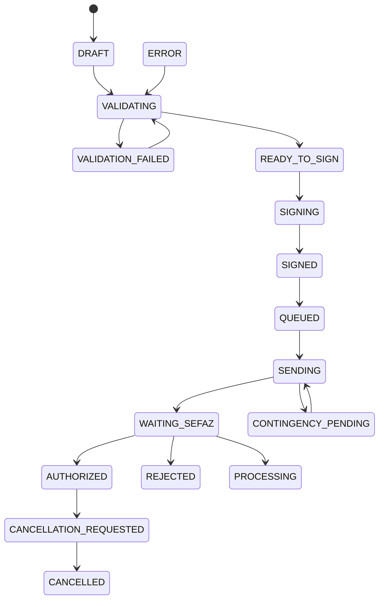

# Requisitos funcionais

## Capacidades

1. **Onboarding**: tenants, aplicações, empresas, estabelecimentos, ambientes, A1, CSC, séries, numeração inicial e perfis fiscais.
2. **Pré-validação**: validar contrato, cadastro, totais, perfil, certificado e schema aplicável sem consumir número.
3. **Emissão**: síncrona com limite curto e assíncrona com aceite imediato; ambas usam a mesma máquina persistente.
4. **Consulta**: ID interno, ID externo, chave, eventos, XML e DANFE.
5. **Pós-autorização**: cancelamento e inutilização no MVP; CC-e e demais eventos entram com NF-e 55.
6. **Contingência**: decisão autorizada, impressão adequada, fila ordenada, transmissão posterior e exceção por divergência.
7. **Integração**: OAuth Client Credentials, scopes, idempotência, correlation ID, webhooks assinados e sandbox.
8. **Operação**: painel, auditoria, reenvio de webhook, reconciliação, status de autorizador e alertas de certificado.

## Máquina de estados

Estados internos: `DRAFT`, `VALIDATING`, `VALIDATION_FAILED`, `READY_TO_SIGN`, `SIGNING`, `SIGNED`, `QUEUED`, `SENDING`, `WAITING_SEFAZ`, `PROCESSING`, `CONTINGENCY_PENDING`, `ERROR`.

Resultados fiscais: `AUTHORIZED`, `REJECTED`, `CANCELLED`, `VOIDED_NUMBER`. `DENIED` só deve existir para documentos/versões em que a regra oficial ainda o reconheça; não generalizar para NFC-e. `CONTINGENCY_AUTHORIZED` é projeção interna: a validade deriva do modo oficial e do resultado posterior, não de um novo estado jurídico inventado.

## Regras centrais

- Total do documento é recalculado pelo serviço; divergência bloqueia a emissão.
- Perfil fiscal é snapshot versionado; alteração futura não muda nota emitida.
- Pré-validação não garante autorização e não reserva número indefinidamente.
- Rejeição fiscal é resposta de domínio; falha técnica e indisponibilidade permanecem distinguíveis.
- Cancelamento/inutilização exigem justificativa e validação da regra vigente.
- XML processado e protocolos nunca são sobrescritos.

## Cenários de alimentação

| Grupo      | Exemplos                                                 | Tratamento                                                                                 |
| ---------- | -------------------------------------------------------- | ------------------------------------------------------------------------------------------ |
| Venda      | balcão, retirada, delivery próprio                       | NFC-e quando aderente à operação/configuração; presença e intermediador explícitos         |
| Pagamento  | dinheiro, Pix, cartão, misto, troco                      | composição deve fechar o total; dados da credenciadora conforme regra vigente              |
| Plataforma | iFood, app próprio, cupom subsidiado                     | separar desconto, comissão e intermediador; responsabilidade fiscal validada pelo contador |
| Produto    | combo, adicional, bebida, monofásico                     | itens fiscais/snapshots definidos pelo perfil; composição comercial não decide tributação  |
| Exceção    | cancelamento, offline, duplicidade, troca de equipamento | máquina persistente, idempotência, série/número e auditoria                                |
| Expansão   | PJ, devolução, complementar, CC-e                        | avaliar NF-e 55 e eventos próprios; fora do MVP NFC-e                                      |

Para cada caso fiscal de homologação, manter entrada, regra versionada, XML esperado, resultado, rejeições conhecidas, schema e Nota Técnica.
