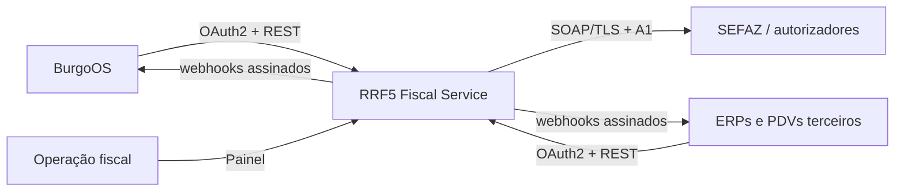
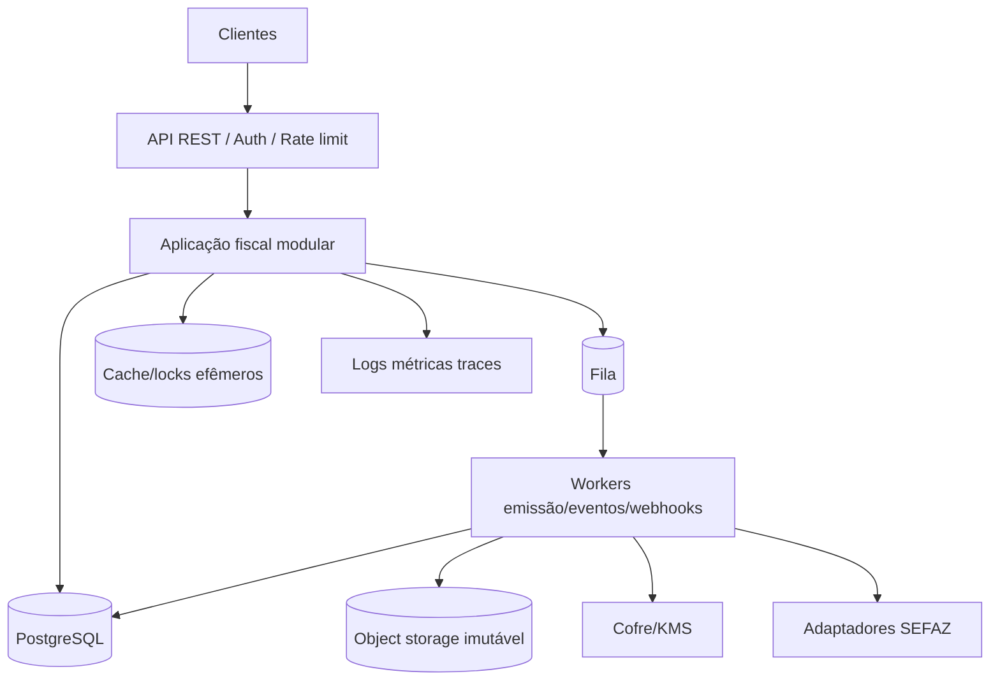
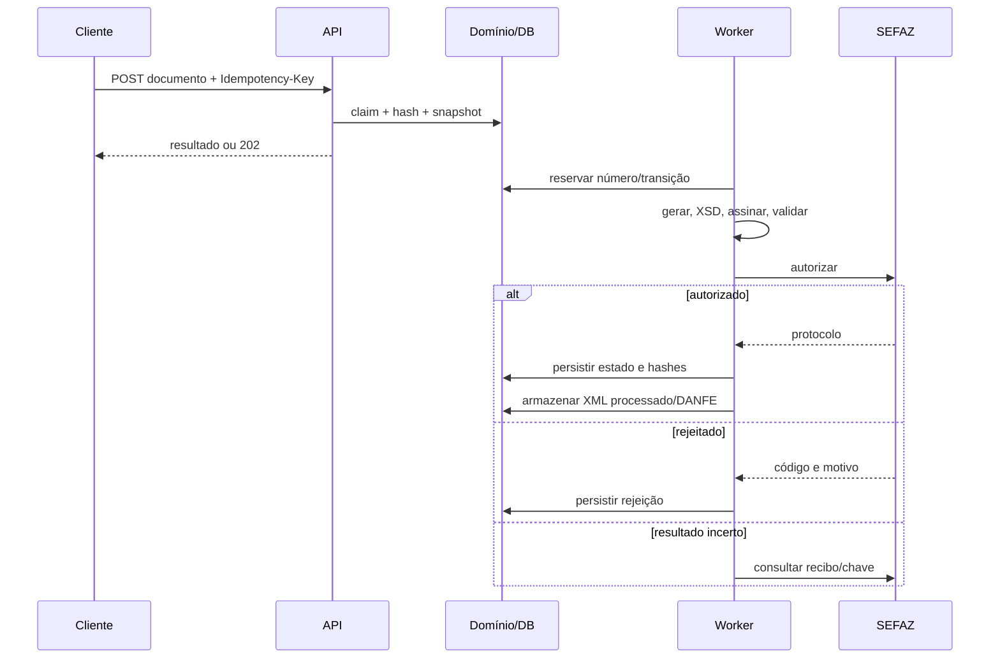

# Arquitetura de referência

## Escolha

**Novo repositório + monólito modular**. API e workers podem escalar/implantar separadamente, mas compartilham domínio e banco no MVP. Extração para microsserviços só ocorrerá por evidência de escala, isolamento ou equipe.

## Contexto

## Contêineres

## Componentes

- Identity & Tenant Access
- Companies & Establishments
- Certificate Vault
- Fiscal Configuration & Tax Rule Versions
- Document Intake & Normalization
- Numbering & Idempotency
- XML/XSD/Signature Pipeline
- Document Model Adapters (65; depois 55)
- Authorizer/UF Adapters
- Emission Orchestrator & Contingency
- Document Store & DANFE
- Events, Webhooks, Audit & Operations
- Regulatory Catalog

## Sequência de emissão

## Decisão de stack

Comparação inicial:

| Stack           | Pontos fortes                                                                            | Risco/custo                                                                    |
| --------------- | ---------------------------------------------------------------------------------------- | ------------------------------------------------------------------------------ |
| Java/Spring     | XML, assinatura, SOAP e ecossistema corporativo maduros                                  | operação/tooling novo para a equipe atual                                      |
| C#/.NET         | excelente suporte criptográfico/XML, bibliotecas fiscais brasileiras e deployment maduro | stack diferente do BurgoOS                                                     |
| Node/TypeScript | experiência atual e contratos compartilháveis                                            | ecossistema fiscal/assinatura/DANFE exige mais validação e risco de biblioteca |

**Recomendação:** executar POCs comparáveis em .NET e Java antes da escolha final. Para o núcleo fiscal, a preferência inicial é **.NET LTS**, atrás de interfaces próprias, se a POC comprovar assinatura, schema, SOAP, DANFE, licença e atualização RTC. TypeScript permanece no cliente BurgoOS e pode servir ao portal; não deve ser escolhido só por familiaridade. A decisão final está no ADR-012.

## Infraestrutura MVP

PostgreSQL, Redis apenas para cache/locks auxiliares, fila durável (RabbitMQ ou gerenciada), storage S3-compatível com versionamento, cofre/KMS via interface, OpenTelemetry e containers. Sem Kubernetes obrigatório.
