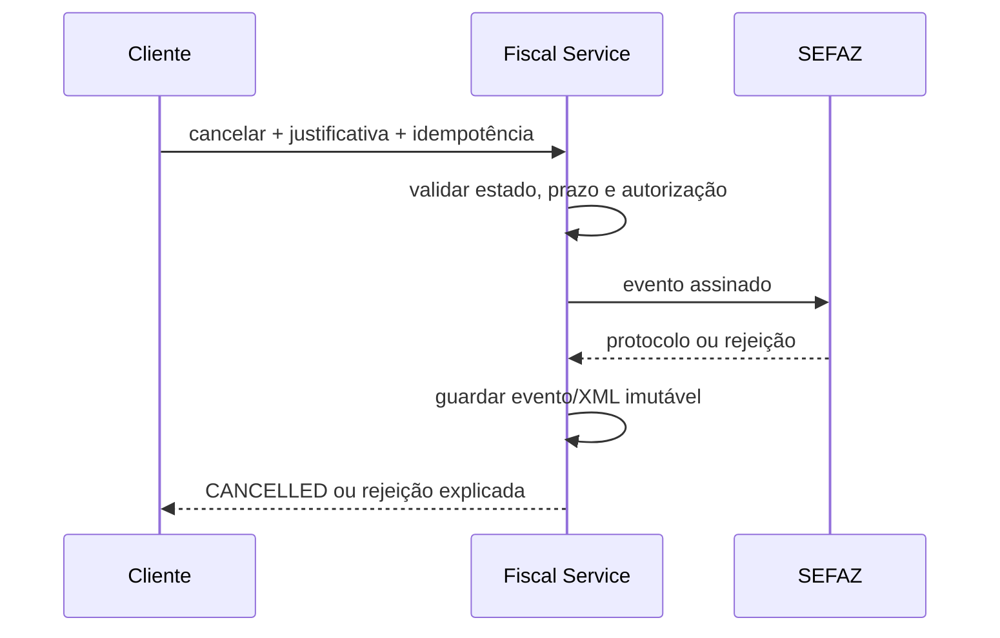
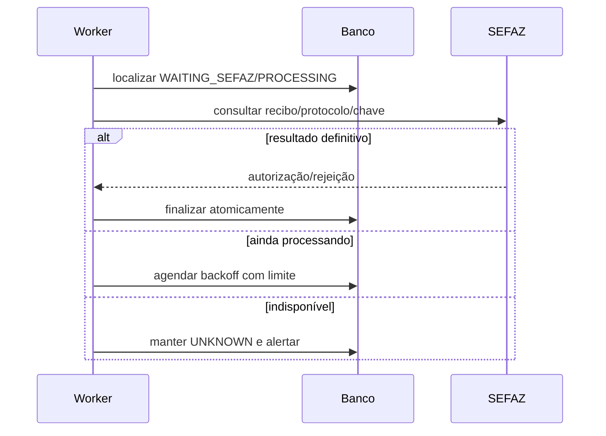

# Fluxos fiscais

## Emissão normal

1. Autenticar aplicação, resolver tenant/estabelecimento e conferir scope.
2. Reivindicar idempotência e persistir snapshot normalizado.
3. Validar cadastro, ambiente, certificado, CSC, totais, pagamentos e regra vigente.
4. Em transação curta, alocar número da série e persistir reserva.
5. Gerar XML na ordem oficial, validar XSD, assinar o elemento aplicável e validar assinatura.
6. Persistir hash do artefato enviado e transmitir ao endpoint versionado.
7. Interpretar resposta; diante de timeout/resultado incerto, consultar recibo/chave antes de reenviar.
8. Para autorização, compor XML processado/protocolo, guardar imutavelmente e gerar DANFE.
9. Publicar evento e webhook após commit.

## Cancelamento

## Consulta posterior de resultado

## Numeração

Preferir atribuição no momento em que o documento está validado e pronto para assinar. Reserva antecipada ampla aumenta lacunas e inutilizações; atribuição tardia reduz lacunas, mas exige lock transacional por série. Nunca decrementar `next_number`. Falha após reserva mantém registro da lacuna; operação autorizada pode inutilizar faixa aplicável. Migração exige termo de corte e último número confirmado pelo emissor anterior.

## Pagamentos e Food Truck

O cliente envia meio comercial estável (`CASH`, `PIX`, `CREDIT_CARD`, `DEBIT_CARD`, `VOUCHER`, `STORE_CREDIT`, `OTHER`), valor, troco e referência adquirente quando disponível. O Fiscal Service resolve o código oficial pela versão vigente. Pagamento posterior, marketplace, gorjeta, cupom subsidiado, comissão e delivery exigem regras explícitas e validação fiscal; comissão não deve alterar silenciosamente o valor fiscal da venda.

## NF-e 55 futura

Destinatário, transporte, referências, devolução, complementar, ajuste, CC-e e manifestação entram por adaptador e contratos adicionais. Não reutilizar fluxo NFC-e omitindo diferenças jurídicas.
