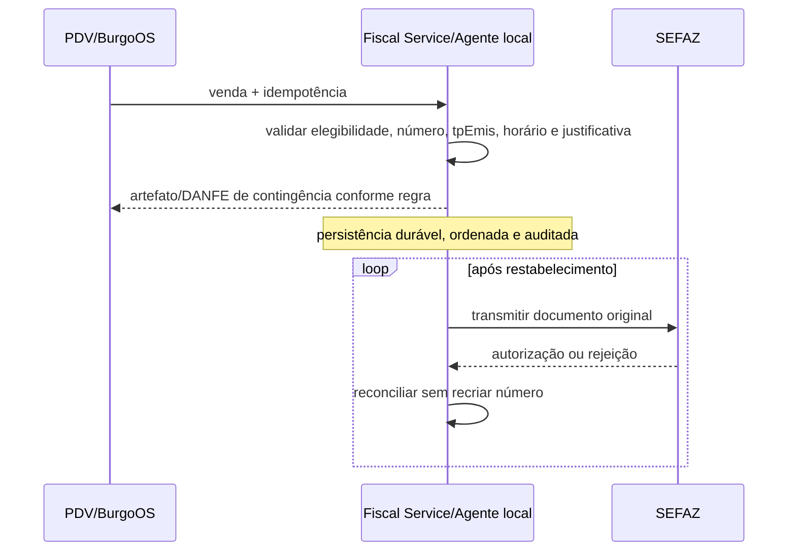

# Estratégia de contingência

## Princípio

Fila e retentativa são resiliência técnica; **não são contingência fiscal**. O modo deve existir na legislação/documentação vigente para modelo, UF e ambiente. Para o MVP NFC-e/SP, considerar contingência offline conforme manual nacional v2.0 e autorização estadual citada pela SEFAZ-SP.

## Fluxo NFC-e offline

## Matriz de falhas

| Falha                              | Conduta                                                                                                                                       |
| ---------------------------------- | --------------------------------------------------------------------------------------------------------------------------------------------- |
| BurgoOS online, SEFAZ indisponível | Fiscal Service detecta/circuit-breaker; ativa contingência apenas sob política oficial e autorização operacional                              |
| BurgoOS sem Fiscal Service         | componente local futuro pode suportar contingência; no MVP sem agente local, bloquear emissão e orientar operação — não fingir offline fiscal |
| Fiscal Service sem SEFAZ           | modo oficial ou estado incerto + consulta posterior                                                                                           |
| Falha após impressão               | preservar número/XML exato; consultar/transmitir original, nunca gerar segunda nota                                                           |
| Autorização posterior divergente   | abrir exceção crítica, preservar evidências e orientar correção fiscal permitida                                                              |
| Offline prolongado                 | alertar prazo, capacidade e risco; impedir operação além dos limites definidos pelo manual/política                                           |

## Controles

- sequência persistente por estabelecimento/série;
- idempotência disponível offline e após reconexão;
- relógio confiável e timezone registrado;
- artefato cifrado localmente, se houver agente;
- capacidade/armazenamento monitorados;
- reconciliação ordenada, com rate limit;
- rejeição posterior nunca é convertida automaticamente em autorização;
- runbook e exercício periódico com evidência.

EPEC/SVC e outras modalidades são habilitadas apenas quando aplicáveis ao documento, autorizador e situação oficial; não são fallback genérico.
