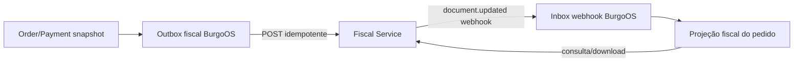

# Inspeção do BurgoOS e integração

## Estado atual observado

- monorepo npm com TypeScript/Node 20+;
- API NestJS modular, REST/OpenAPI, validação por DTO;
- frontend Next.js App Router;
- Prisma + PostgreSQL compartilhado pelos domínios;
- JWT/refresh token, tenant ativo e catálogo de permissões;
- Socket.io e scheduler; sem broker, Redis, object storage fiscal ou KMS no ambiente local;
- integrações externas encapsuladas em clientes/serviços e webhooks já usados em pagamentos.

## Avaliação

O padrão modular é adequado ao cliente fiscal, mas o núcleo fiscal não deve entrar no mesmo deploy/banco. O domínio tem retenção, disponibilidade, credenciais, numeração, protocolos e calendário regulatório próprios. Uma falha no fiscal não pode derrubar captura/KDS; uma release de cardápio não deve reiniciar workers fiscais.

## Fronteira proposta

BurgoOS possui pedido, itens comerciais, personalizações, pagamentos e decisão operacional. Fiscal Service possui configuração tributária, certificado, série/número, XML, protocolo, DANFE, eventos e contingência.

## Dados no BurgoOS

Persistir somente `tenantId`, `orderId`, `fiscalDocumentId`, `externalId`, modelo, ambiente, estado, chave/protocolo quando autorizado, timestamps e último erro sanitizado. Não persistir A1, senha, CSC ou XML como fonte oficial.

## Contrato operacional

- `externalId` estável: `burgoos:{tenant}:{order}` ou identificador opaco equivalente.
- `Idempotency-Key` derivada de tentativa fiscal persistida, nunca de timestamp aleatório.
- Snapshot inclui itens e pagamentos finais; alterações após autorização seguem operação fiscal própria.
- Webhook é inbox idempotente; o BurgoOS consulta `GET /documents/{id}` antes de projetar estado crítico.
- Em falha fiscal, pedido/KDS seguem política configurada; não marcar nota como rejeitada por timeout.

## Migração para novo repositório

Os documentos desta pasta devem iniciar o novo repositório `rrf5-fiscal-service`. No BurgoOS permanecem este resumo/ADR de fronteira e o OpenAPI consumido ou um pacote de contrato versionado. Repositórios terão pipelines, secrets, banco e deploy independentes.
